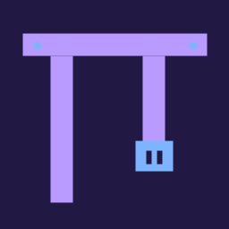
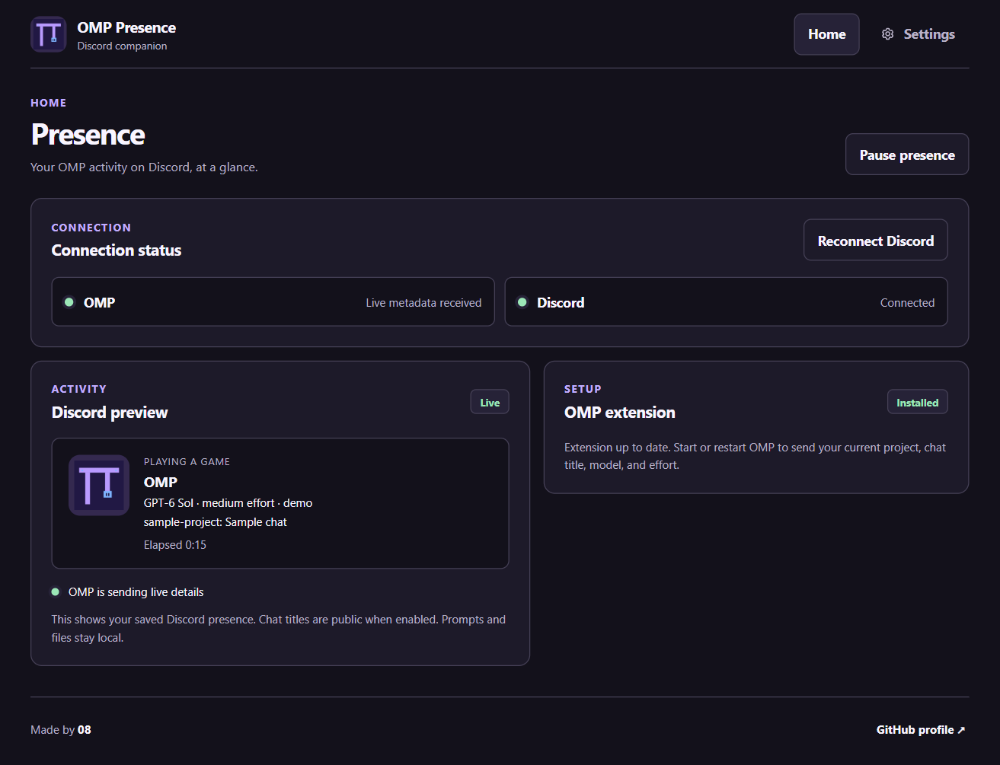
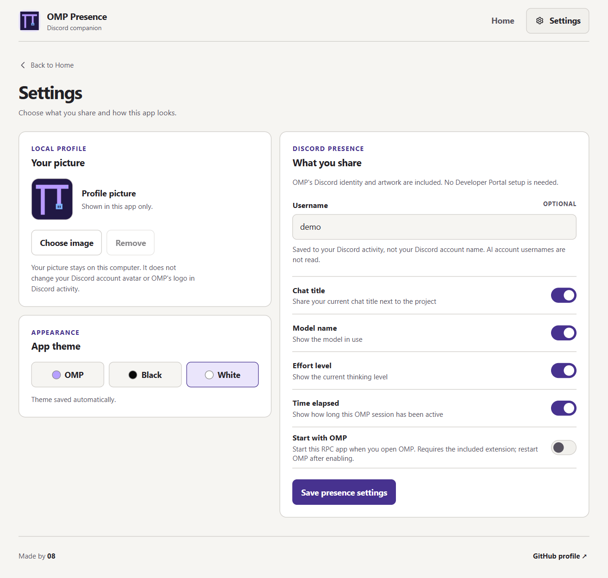

<div align="center">
  
  <h1>OMP Presence</h1>
  <p>Your OMP work, visible on Discord. Your details, your choice.</p>
  <p>
    <a href="https://github.com/082-0/omp-presence/releases/latest/download/OMP-Presence-v7-Windows.exe">Download v7 for Windows</a>
    &nbsp;·&nbsp; <a href="#screenshots">Screenshots</a>
    &nbsp;·&nbsp; <a href="https://github.com/082-0/omp-presence/discussions/1">Join the v7 discussion</a>
  </p>
</div>

OMP Presence can show your project, optional chat title, model, effort level, and session timer. You choose what appears in your Discord activity. v7 is the current portable Windows release. It does not need an installer.

**macOS and Linux support is coming soon.** Neither platform has a download yet. The current OMP process detector targets Windows.

## Screenshots

<a href="docs/screenshots/v7-home.png"></a>

<a href="docs/screenshots/v7-settings.png"></a>

The screenshots use sample data. They do not show a real account, chat, or live Discord session.

## From the beta to v7

| Build | What changed |
| --- | --- |
| [v1 beta](https://github.com/082-0/omp-presence/releases/tag/v1) | Model and effort on Discord. Users supplied their own Discord application ID. |
| [v2](https://github.com/082-0/omp-presence/releases/tag/v2) | The app included the public OMP application ID. |
| [v3](https://github.com/082-0/omp-presence/releases/tag/v3) | Setup steps stopped showing after the extension was installed. |
| [v4](https://github.com/082-0/omp-presence/releases/tag/v4) | The app detected OMP without live extension data. |
| [v5](https://github.com/082-0/omp-presence/releases/tag/v5) | Project name, optional chat title, username, and safer extension updates. |
| [v6](https://github.com/082-0/omp-presence/releases/tag/v6) | First dashboard redesign, three themes, and a fallback to saved session details. |
| **[v7](https://github.com/082-0/omp-presence/releases/tag/v7)** | Focused Home and Settings screens, a local picture, and optional startup with OMP. |

Each link opens that version's Windows download. Older builds are kept for history; v7 is recommended. This repository starts with the v7 source, not invented earlier commits. [Read the full version history](CHANGELOG.md).

## Run v7 on Windows

1. Download [OMP Presence v7 for Windows](https://github.com/082-0/omp-presence/releases/latest/download/OMP-Presence-v7-Windows.exe).
2. If an older OMP Presence copy is open, right-click its system tray icon and choose **Quit**. Closing its window only hides it.
3. Open the v7 EXE. Keep Discord desktop open and signed in.
4. If the app asks for the OMP extension, install it from Home and restart OMP. The extension sends the project name, optional chat title, model, and effort. If you use a named OMP profile, copy [`extension/omp-presence.js`](extension/omp-presence.js) into that profile's `agent/extensions` folder.
5. Open Settings with the gear. Enter a username if you want one in your Discord activity. Choose which details to share, then click **Save presence settings**.

The OMP, Black, and White themes save as soon as you select them. You can also choose a local profile picture. This picture appears in the app only. Your Discord account picture and the OMP artwork on the activity card do not change.

**Start with OMP** is off by default. If you enable it, click **Save presence settings** and restart OMP. The extension then starts this EXE when you open OMP. If you move the EXE, run it once from the new location. This setting does not start the app when Windows starts.

## Quick answers

**Do I need a Discord application ID?** No. V2 and later include the public OMP application ID. You do not need a bot token or the Discord Developer Portal.

**Does the app post my prompts?** No. The extension writes the project folder name, optional chat title, model, effort, and time to a local file. Prompts, tool output, and full project paths are not sent to Discord. A chat title is public when you turn on **Chat title**.

**Why does an old screen appear after I open v7?** An older copy is still running in the tray. Quit that copy first. OMP Presence allows only one running copy.

## Talk about the next release

Join the [v7 discussion](https://github.com/082-0/omp-presence/discussions/1) to share your setup, ask questions, or suggest a change. Tell us which OMP version and Windows version you use. Do not post private chat titles, session files, or login tokens. Use [Issues](https://github.com/082-0/omp-presence/issues) for a reproducible bug. macOS and Linux support is planned, but neither platform is available yet.

## Build from source

Use Node.js 22.13 or later on Windows. Run these commands from the project folder:

```sh
npm ci
npm test
npm run build:win
```

The portable EXE appears in `dist/`. Use `npm start` to run the app from source. The app uses Electron and the local Discord connection. The OMP extension is in `extension/`. Source, tests, artwork, and screenshots are in this repository. The Windows EXE is a release download, not a file in Git.

## Privacy and limits

The OMP extension writes the process ID, project folder name, optional chat title, model ID, effort level, and timestamps to `%APPDATA%\omp-presence\live`. The app reads the latest entry. It expires after 12 seconds. Without an entry, the app can read only the title and working directory from the first two lines of a local OMP session file. It uses only the folder name, not the full path. The extension removes its entry when OMP closes normally.

Settings are stored in `%APPDATA%\omp-presence\settings.json`. A chosen profile picture is stored in `%APPDATA%\omp-presence\avatar.png`. The optional OMP start setting also stores the EXE path and the running process ID in that folder. The app does not read login tokens or account names. The timer starts when the app detects OMP. With several OMP sessions, it cannot know which terminal has keyboard focus.

Closing the window leaves the app in the Windows system tray. Right-click the tray icon to pause or quit. Pausing stops Discord activity. The OMP extension can still update its local file while OMP runs.

## Credits

Made by [08](https://github.com/082-0). The OMP mark is based on the [OMP icon](https://github.com/can1357/oh-my-pi/blob/main/assets/icon.svg). The bundled public Discord application ID and `logo` artwork belong to the shared [OMP Discord presence application](https://github.com/abilliontokens/omp-discord-presence). This project does not control that application's future availability. OMP Presence is not affiliated with Discord.
